<div align="center">



</div>

```console
Jabez0701@~$ ls contact/
```

[](mailto:sfs24jabezcs@gmail.com)

```console
Jabez0701@~$ cat stack.txt
```

             

```console
Jabez0701@~$ gh stats --user jabez0701
```

<p>
  
  
</p>


```console
Jabez0701@~$ _
```
